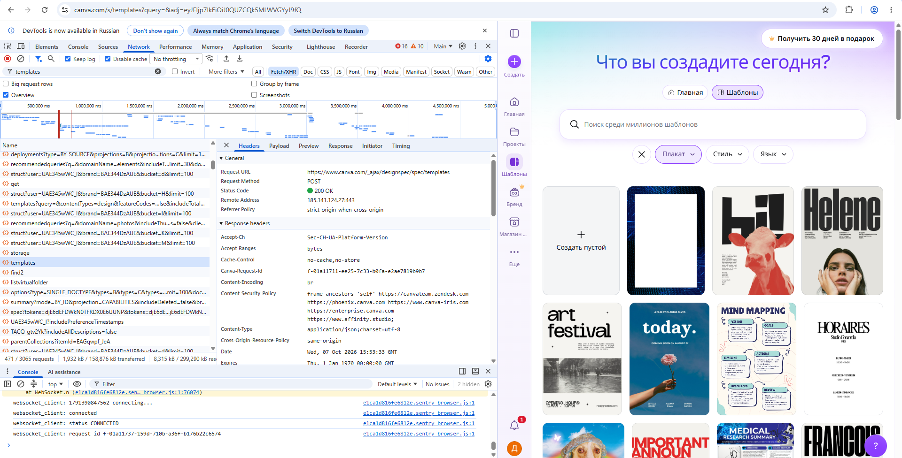
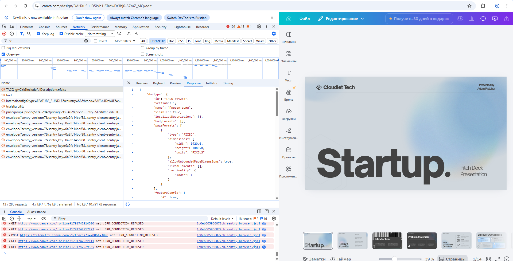
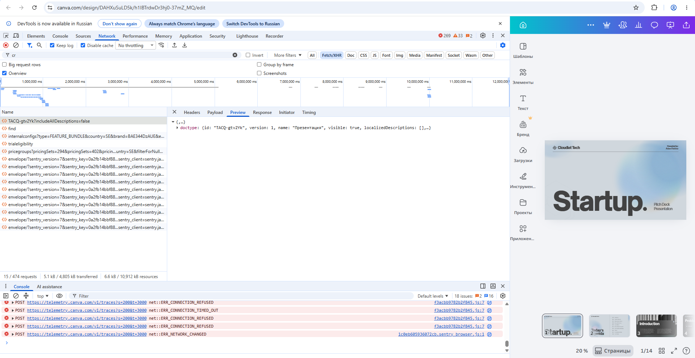
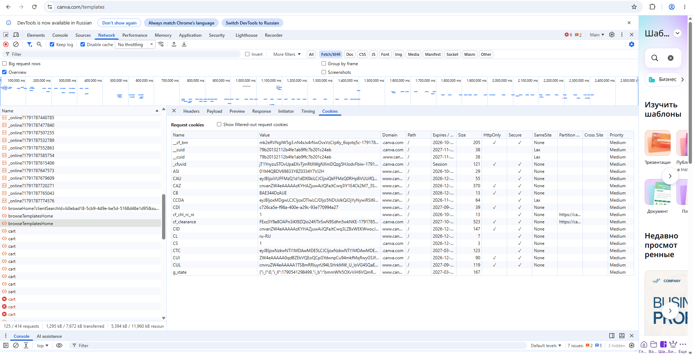
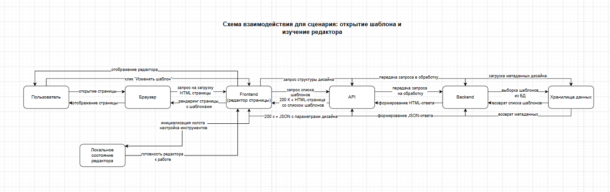

# computer-science-lab2
# Лабораторная работа №2

## Анализ веб-приложения и клиент-серверного взаимодействия

## 1. Исследуемая информационная система

Для выполнения лабораторной работы был выбран сервис Canva и пользовательский сценарий: открытие шаблона и изучение редактора.
Canva — это облачная платформа для визуальных коммуникаций, позволяющая создавать и редактировать дизайны (презентации, посты для соцсетей, документы) без ручного написания кода. Пользователь работает через веб-интерфейс, который формирует запросы к серверу, а сервер возвращает данные и обновляет состояние дизайна.

В ходе исследования были выделены следующие основные компоненты:

- браузер пользователя;
- интерфейс сайта (frontend);
- клиентский JavaScript, который управляет редактированием дизайна;
- API-сервис, принимающий запросы от клиента;
- backend, реализующий обработку данных;
- хранилище данных, в котором сохраняются дизайны, страницы и элементы;
- внешние сервисы и ресурсы (CDN, аналитика, авторизация, загрузка статических файлов).

### 1.1. Сценарий исследования

Исследуемый сценарий:

1. Авторизация в личном кабинете Canva.
2. Поиск подходящего шаблона через вкладку «Шаблоны» или поисковую строку.
3. Выбор шаблона из предложенных вариантов.
4. Нажатие кнопки «Изменить шаблон» для открытия в редакторе.
5. Изучение интерфейса редактора (боковые панели, рабочая область).
6. Проверка доступных элементов управления.

## 2. Анализ HTTP-запросов

В работе для изучения сетевого взаимодействия использовалась вкладка Network в браузерных DevTools. Перед началом сценария список запросов был очищен, после чего были выполнены действия, связанные с открытием страницы выбора шаблонов и изучением редактора. В результате удалось наблюдать сетевые обращения, которые обеспечивали загрузку интерфейса, получение данных шаблонов и передачу изменений на сервер.

### 2.1. Основные наблюдения

Во время исследования были замечены следующие типы HTTP-запросов:

- GET-запросы для загрузки HTML, CSS, JavaScript и изображений;
- POST-запросы для отправки данных на сервер после действия пользователя;
- запросы на получение/обновление данных дизайна и структуры проекта;
- служебные запросы, связанные с сессией, авторизацией и аналитикой.

### 2.2. Таблица HTTP-запросов

Ниже приведены типичные запросы, обнаруженные в ходе исследования. Для безопасности и корректности отчета реальные значения cookies, токены и идентификаторы не приводятся, а вместо них указаны типы и назначение данных.

| № | Метод	|                         URL / тип запроса	                    | Статус |                      	Назначение                           |
|---|-------|---------------------------------------------------------------|--------|---------------------------------------------------------------|
| 1 | GET   | /templates/?query={query}                                  	| 200	 | Загрузка страницы поиска шаблонов                             | 
| 2 | GET   | https://static.canva.com/web/editor/runtime.min.js          	| 200	 | Загрузка JavaScript frontend                                  | 
| 3 | GET   | /api/templates/get/?templateid={id}	                        | 200	 | Получение данных выбранного шаблона                           | 
| 4 | GET   | https://media.canva.com/templates/preview_{id}.png	        | 200	 | Загрузка изображения превью шаблона                           | 
| 5 | GET   | /api/elements/list/	                                        | 200    | Получение списка элементов для боковой панели                 | 
| 6 | POST  | /api/design/get/getdesign/	                                | 200	 | Получение данных структуры дизайна                            | 
| 7 | POST  | /api/editor/init/	                                            | 200	 | Инициализация редактора                                       | 
| 8 | POST  | /api/design/submit/updateundobutton/	                        | 200	 | Служебный аналитический запрос                                | 

### 2.3. Запросы, относящиеся к пользовательскому сценарию

К выбранному сценарию относятся те запросы, которые были запущены при переходе на страницу выбора шаблонов. В частности, после активации элемента интерфейса (вкладка «Шаблоны» или ввод поискового запроса) браузер инициировал запрос на загрузку страницы с выбором шаблонов и получение списка доступных шаблонов. Это подтверждает, что интерфейс работает не локально, а через сетевой обмен данными с сервером.

Наблюдаемый факт: после действия «Открыть шаблоны» в DevTools появился HTTP GET-запрос GET /templates/?query={query}, который связан с загрузкой страницы поиска шаблонов. Данный запрос на скриншоте из DevTools отображается в списке запросов под именем templates.

Предположение: запрос обрабатывается API-сервисом, который затем возвращает HTML-страницу со списком шаблонов, и браузер рендерит её в интерфейсе пользователя.

Скриншот: запрос

### 2.4. Важное уточнение о редактировании шаблона

При анализе сценария было установлено, что непосредственное редактирование шаблона в редакторе Canva происходит преимущественно на стороне браузера (client-side), а не через постоянные POST-запросы к серверу при каждом действии пользователя.

Это означает, что при перемещении элементов, изменении цвета, добавлении текста и других операциях редактирования браузер не отправляет отдельный POST-запрос на сервер для каждой манипуляции. Все изменения накапливаются локально в состоянии клиентского приложения, а синхронизация с сервером происходит периодически или при определённых событиях (например, автосохранение, закрытие редактора, явное сохранение).

Наблюдаемый факт: при выполнении множества операций редактирования (перемещение элементов, изменение свойств) в DevTools не появляется отдельный POST-запрос на каждое действие.

Предположение: редактор Canva использует клиентскую модель состояния с отложенной синхронизацией, что снижает нагрузку на сервер и обеспечивает отзывчивость интерфейса.

## 3. Анализ HTTP-ответов

После выполнения запроса сервер возвращает HTTP-ответ, в котором содержатся статус-код, заголовки и тело ответа. Для анализа были выбраны два запроса: один на загрузку страницы поиска шаблонов и один на получение данных структуры дизайна.

### 3.1. Пример анализа ответа на запрос страницы

Для запроса загрузки страницы поиска шаблонов был получен ответ со статусом 200 OK. Это указывает на успешную загрузку страницы, после чего браузер начал рендерить интерфейс.

Основные наблюдаемые заголовки:

- Content-Type: text/html или application/json;
- Cache-Control: политика кэширования содержимого;
- Expires: политика кэширования содержимого;
- Date: дата и время ответа;
- Server: название серверного программного обеспечения (если было видно в заголовках);

Тело ответа представляло HTML-страницу или данные шаблонов, необходимые для инициализации интерфейса поиска.

### 3.2. Пример анализа ответа на запрос получения структуры дизайна

Для API-запроса, связанного с получением данных структуры дизайна при открытии редактора, был получен ответ со статусом 200, что соответствует успешной операции. В ответе сервер вернул JSON с описанием дизайна — его типа, размеров, страниц и конфигурации.
 
 Пример структуры ответа:

json
{
  "doctype": {
    "id": "TACQ-gtv2Yk",
    "version": 1,
    "name": "Презентация",
    "visible": true,
    "localizedDescriptions": {},
    "bodyFormats": [],
    "pageFormats": [
      {
        "type": "FIXED",
        "dimensions": {
          "width": 1920.0,
          "height": 1080.0,
          "units": "PIXELS"
        },
        "allowUnboundedPageDimensions": true,
        "fixedElements": [],
        "cardinality": {
          "lower": 1
        }
      }
    ],
    "featureConfig": {
      "A": true,
      ...
    }
  }
}

id — уникальный идентификатор дизайна (TACQ-gtv2Yk);
name — название дизайна («Презентация»);
pageFormats — формат страниц, включая размеры (width: 1920, height: 1080) и единицы измерения (PIXELS);
featureConfig — конфигурация доступных функций редактора.

Наблюдаемый факт: сервер возвращает JSON-ответ с параметрами дизайна (тип, размеры, формат страниц).

Предположение: эти данные используются frontend-редактором для инициализации рабочей области — установки размеров холста, настройки доступных инструментов и отображения структуры страниц.

Браузер получил эти данные и обновил интерфейс, загрузив шаблон в рабочую область редактора с указанными размерами (1920 × 1080 пикселей).

### 3.3. Наблюдаемые факты и предположения

Наблюдаемый факт: сервер возвращает JSON-ответ при получении структуры дизайна, после чего редактор работает с этой структурой локально.

Предположение: backend выполняет валидацию данных, сохраняет состояние дизайна и возвращает результат клиенту только при синхронизации.

Предположение: часть логики может быть вынесена в отдельный API-сервис, но это нельзя установить напрямую без доступа к серверной реализации.

## 4. Анализ параметров и передаваемых данных

При выполнении пользовательского сценария браузер передавал серверу информацию, которая позволяла понять, какой объект редактируется и какое действие нужно выполнить.

### 4.1. Параметры запроса

В запросах, связанных с открытием страницы выбора шаблонов, можно было выделить следующие типы параметров:

В URL-параметрах query string:
- поисковый запрос пользователя (query);
- фильтры по типу дизайна;
- пагинация.

Для запроса получения структуры дизайна (из п. 3.2) в URL передавались параметры:

- TACQ-gtv2Yk — идентификатор дизайна (внутренний ID ресурса);
- includeAllDescriptions=false — флаг, указывающий, нужно ли включать все описания в ответ.

В заголовках:

- время операции;

- версия браузера;
- кодировка браузера;
- Content-type (тип передаваемых данных);
- идентификатор сессии (внутри cookie).

### 4.2. Где находятся данные

Параметры были расположены следующим образом:

- часть данных — в URL-параметрах query string;
- основная часть данных — в теле HTTP-запроса (payload);
- служебные данные — в cookie и заголовках запроса.

Пример структуры данных в body запроса:
      
comm=createnewdesign
templateid=18
type=presentation
width=1920
height=1080

### 4.3. Какие данные передаются при открытии шаблона

При открытии страницы с выбором шаблонов сервер получает:

- поисковый запрос пользователя (если был введён);
- фильтры по типу контента;
- параметры пагинации;
- когда операция была выполнена.

В ответе сервер возвращал HTML-страницу со списком шаблонов и метаданными для их отображения, чтобы пользователь видел результаты поиска без перезагрузки страницы.

.png)

## 5. Анализ cookies

Cookies используются в веб-приложениях для хранения небольших данных, которые браузер должен отправлять серверу при последующих запросах. В Canva это может использоваться для авторизации, идентификации сессии, аналитики и хранения пользовательских настроек.

### 5.1. Что было обнаружено

Для исследуемого сайта были просмотрены cookies через вкладку Application / Storage, а также через вкладку Cookies в панели Network при выбранном запросе. На скриншоте DevTools отображается таблица Request cookies для запроса browseTemplatesHome — именно этот запрос отвечает за загрузку страницы с выбором шаблонов, что напрямую соответствует исследуемому сценарию.

Ниже приведён анализ обнаруженных cookies с указанием домена, срока действия, назначения и флагов безопасности.

| Имя cookie	 | Домен         |	Срок действия          |	Назначение               |	Флаги                                       |	Комментарий                                                           |
|----------------|---------------|-------------------------|-----------------------------|----------------------------------------------|-------------------------------------------------------------------------|
| __cf_bm        | .canva.com	 | 2026-10-... (≈30 минут) | Управление ботами           | Cloudflare	HttpOnly, Secure, SameSite=Lax  | наблюдаемый факт: защита от автоматизированного трафика                 |
| _cuid          | 	.canva.com	 | 2027-11-...	           | Идентификация пользователя	 | HttpOnly, Secure                             | предположение: используется для распознавания пользователя              |
| _cuid (второй) | 	.canva.com	 | 2027-11-...	           | Идентификация пользователя  | HttpOnly, Secure                             | наблюдаемый факт: дублирующая запись для разных путей                   |
| _cfuvid        | 	.canva.com	 | Session	               | Идентификация сессии        | Cloudflare	HttpOnly, Secure, SameSite=None | наблюдаемый факт: используется для различения пользователей за общим IP |
| ASI	         | .canva.com	 | 2026-10-...	           | Служебные данные сессии     | HttpOnly, Secure                             | предположение: аналитика или сессия                                     |
| CAU	         | .canva.com	 | 2026-12-...	           | Аутентификация	             | HttpOnly, Secure                             | предположение: используется для авторизации                             |
| CAZ	         | .canva.com	 | 2026-12-...	           | Аутентификация	             | HttpOnly, Secure                             | предположение: используется для авторизации                             |
| CB	         | .canva.com	 | 2026-12-...	           | Служебные данные	         | HttpOnly, Secure                             | предположение: вспомогательная функция                                  |
| CCDA	         | .canva.com	 | 2026-12-...	           | Служебные данные	         | HttpOnly, Secure                             | предположение: вспомогательная функциям                                 |
| CDI	         | .canva.com	 | 2027-09-...	           | Идентификация устройства    | HttpOnly, Secure                             | предположение: используется для распознавания устройства                |
| cf_chl_rc_i    | .canva.com	 | 2026-10-...	           | Cloudflare-защита	         | HttpOnly, Secure                             | наблюдаемый факт: служебная запись Cloudflare                           |
| cf_clearance   | .canva.com	 | 2027-10-...	           | Cloudflare-защита	         | HttpOnly, Secure, SameSite=None              | наблюдаемый факт: пропуск проверки Cloudflare                           |
| CID	         | .canva.com	 | 2026-12-...	           | Идентификация клиента	     | HttpOnly, Secure                             | предположение: используется для аналитики                               |
| CL	         | .canva.com	 | 2026-12-...	           | Локализация	             | Secure, SameSite=Lax                         | предположение: языковые настройки (ru-RU)                               |
| CS	         | .canva.com	 | 2026-12-...	           | Безопасность и верификация	 | HttpOnly, Secure                             | наблюдаемый факт: используется для защиты сессии                        |
| CTC	         | .canva.com	 | 2027-03-...	           | Безопасность                | 	HttpOnly, Secure                            | предположение: вспомогательная защита                                   |
| CUI	         | .canva.com	 | 2026-12-...	           | Идентификация пользователя	 | HttpOnly, Secure                             | предположение: распознавание пользователя                               |
| CUL	         | .canva.com	 | 2027-09-...	           | Идентификация пользователя	 | HttpOnly, Secure                             | предположение: распознавание пользователя                               |
| g_state	     | .canva.com	 | 2027-03-...	           | Состояние Google-интеграции | Secure                                       | предположение: связано с Google-аккаунтом                               |

### 5.2. Анализ результатов

Наблюдаемый факт: на сайте используются cookies с флагами Secure и HttpOnly, которые отправляются вместе с запросами к домену .canva.com. Основные типы:

- Cookies безопасности Cloudflare — __cf_bm, cf_clearance, cf_chl_rc_i, _cfuvid. Они обеспечивают защиту от автоматизированного трафика и управление бот-трафиком. Флаг SameSite=None у cf_clearance и _cfuvid указывает на использование cookie в кросс-доменных сценариях.

- Cookies аутентификации и идентификации — CAU, CAZ, CUI, CUL, CID, CDI, _cuid. Они имеют длительный срок действия (до 2027 года) и предназначены для распознавания пользователя, его устройства и поддержания сессии.

- Служебные cookies — ASI, CB, CCDA, CS, CTC. Вероятно, используются для хранения вспомогательных данных сессии и безопасности.

- Cookies локализации — CL со значением ru-RU и флагом SameSite=Lax. Используется для выбора языка интерфейса.

- Cookies интеграции с Google — g_state, связана с состоянием Google-аккаунта.

Предположение: часть cookies отвечает за авторизацию и сессию, часть — за аналитику, защиту и настройки интерфейса.
Согласно официальной политике, «Essential» cookies всегда включены для обеспечения безопасности и корректной работы сайтов и сервисов. Согласно политике конфиденциальности, Canva использует Cookie для идентификации пользователей при входе в систему, сохранения настроек и оптимизации пользовательского опыта.
Если назначение cookie нельзя установить точно, это отмечено как предположение, а не как факт.

## 6. Взаимодействие Frontend, API и Backend

Для выбранного пользовательского сценария важным является понимание цепочки событий от действия пользователя до визуального обновления интерфейса.

### 6.1. Последовательность событий

- Пользователь
- Интерфейс редактора
- JavaScript / frontend-логика
- HTTP-запрос к API
- Backend-сервис
- Обработка и сохранение данных
- HTTP-ответ
- Обновление интерфейса
- Пользователь видит открытый шаблон в редакторе

### 6.2. Конкретное действие

Рассмотрим действие: пользователь переходит на страницу с выбором шаблонов, чтобы выбрать подходящий вариант.

1. Пользователь взаимодействует с UI-элементом страницы (вкладка «Шаблоны» или поисковая строка).
2. Frontend реагирует на действие и формирует HTTP-запрос.
3. Браузер отправляет запрос на адрес (GET /templates/?query={query}), при этом в заголовках передаются cookies, включая CL=ru-RU (локализация), CS (безопасность сессии) и другие.
4. Сервер принимает запрос и обрабатывает его.
5. Backend обрабатывает данные: применяет фильтры, формирует список шаблонов.
6. Сервер возвращает ответ со статусом успеха (HTML-страница со списком шаблонов).
7. JavaScript frontend получает ответ и обновляет визуальную структуру страницы — отображает список шаблонов.
8. Пользователь видит страницу с выбором шаблонов.
9. При нажатии кнопки «Изменить шаблон» браузер открывает редактор, который запрашивает структуру дизайна. В ответ на этот запрос сервер возвращает JSON с параметрами дизайна (doctype, name, pageFormats, featureConfig). Frontend использует эти данные для настройки рабочей области редактора — размеров холста (1920 × 1080) и доступных инструментов.

### 6.3. Вывод по архитектуре

В результате исследования было подтверждено, что взаимодействие между клиентом и сервером происходит через HTTP. Браузер не хранит состояние дизайна в единственном локальном файле; он получает и отправляет данные через API, что позволяет приложению обновлять интерфейс динамически, без полной перезагрузки страницы.

## 7. Сопоставление с архитектурой из лабораторной работы №1

По результатам первой лабораторной работы была построена предварительная архитектурная схема системы. Во второй лабораторной она была сопоставлена с реальным сетевым поведением приложения.

### 7.1. Что удалось подтвердить

Были подтверждены следующие элементы архитектуры:

- браузер пользователя является входной точкой взаимодействия;
- frontend загружает интерфейс, обрабатывает действия пользователя и формирует HTTP-запросы;
- участвует в обмене данными между клиентом и сервером;
- backend отвечает за обработку запросов и обновление состояния страницы;
- данные сохраняются в хранилище данных, а не только в памяти браузера;
- cookies используются для поддержания пользовательской сессии, локализации и защиты;
- редактирование контента происходит на стороне клиента с периодической синхронизацией.

Согласно документации Canva Apps SDK, приложения — это веб-страницы, встроенные в редактор Canva, и они имеют доступ к стандартным веб-технологиям, таким как Fetch API, что позволяет им интегрироваться с backend-сервисами.

### 7.2. Что остается предположительным

Некоторые элементы архитектуры не были видны напрямую из DevTools, поэтому они остаются предположениями:

- какая именно база данных используется на сервере;
- на каком языке реализован backend;
- используется ли отдельный API gateway;
- какая часть обработки вынесена во внешние сервисы;
- есть ли кеширование на стороне сервера или CDN.

### 7.3. Дополнение архитектурной схемы

После исследования стало понятно, что взаимодействие идет по следующей схеме:

- Пользователь
- Браузер
- Frontend
- API
- Backend
- Хранилище данных

и при необходимости возможно присутствие внешних сервисов для аналитики, CDN и авторизации.

## 8. Схема взаимодействия компонентов

На основании проведенного анализа была построена отдельная схема взаимодействия компонентов для сценария открытия шаблона.

На схеме отражены:

- пользователь;
- браузер;
- frontend;
- API;
- backend;
- хранилище данных;
- направления обмена данными;
- HTTP-запросы и HTTP-ответы;
- JSON-передача данных;
- обновление интерфейса после ответа сервера.

## 9. Вывод

В ходе лабораторной работы было проведено исследование HTTP-взаимодействия в веб-приложении Canva на выбранном сценарии «открытие страницы с выбором шаблонов и изучение редактора». Было установлено, что интерфейс работает через клиентский JavaScript, который отправляет HTTP-запросы к серверу, а сервер отвечает данными и статусами выполнения операции.

Были выявлены следующие важные результаты:

- браузер и frontend тесно взаимодействуют для обработки пользовательского действия;
- запросы к API выполняются при загрузке страницы с шаблонами и при получении структуры дизайна;
- открытие страницы с шаблонами сопровождается HTTP GET-запросом и ответом сервера;
- данные передаются в URL и в теле запроса, а также хранятся в cookies (CL, CS, CUI, CAZ и другие);
- обратно пользователю приходит результат, который обновляет интерфейс без полной перезагрузки страницы;
- редактирование шаблона в редакторе происходит преимущественно на стороне клиента — изменения накапливаются локально и синхронизируются с сервером периодически, а не при каждом действии.

Согласно документации Canva, приложения могут интегрироваться с backend-сервисами, используя стандартный Fetch API, что подтверждает клиент-серверную архитектуру платформы.

Главный вывод состоит в том, что современное веб-приложение является распределенной системой: пользователь взаимодействует с UI, frontend формирует сеть запросов, API организует обмен данными, а backend обрабатывает их и сохраняет состояние. При этом важной особенностью является возможность клиентского редактирования с отложенной синхронизацией, что обеспечивает высокую отзывчивость интерфейса. Важным является также разделение фактов и предположений: факты подтверждены в DevTools, а предположения обозначены как гипотезы, поскольку без доступа к серверной части нельзя установить внутреннюю реализацию с абсолютной уверенностью.нельзя установить внутреннюю реализацию с абсолютной уверенностью.

### 9.1. Результаты работы

- Подтверждено: наличие HTTP-запросов при работе с редактором.
- Подтверждено: наличие API-взаимодействия между frontend и backend.
- Подтверждено: использование cookies и заголовков HTTP для поддержания сессии и передачи данных.
- Подтверждено: обновление интерфейса после получения ответа сервера.
- Предположительно: конкретная реализация backend и структура внутренних сервисов.

В результате лабораторная работа была оформлена в виде отчета с описанием сетевого взаимодействия, таблицами запросов, анализом параметров и cookies, а также архитектурной схемой сценария.
